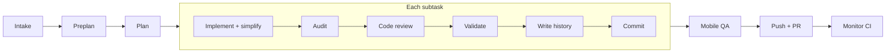

<div align="center">


# Skill Bill

**Governed feature workflows for AI coding agents.**
Issue in, reviewed and tested pull request out, with progress that survives interruptions.

[](LICENSE)


[Quickstart](#quickstart) · [How it works](#how-it-works) · [Commands](#commands) · [Watching runs](#watching-and-controlling-runs) · [Platform packs](#platform-packs) · [Configuration](#configuration) · [Docs](#documentation)

</div>

---

Skill Bill turns an issue and its acceptance criteria into a pull request. It plans the work, implements it, audits it against the criteria, reviews and fixes it, runs your project's checks, tests the app on a device, and opens the PR. A local runtime records every phase, so a crashed or paused run picks up where it stopped.

It works with Claude Code, Codex, and Cursor. You install one skill, `/skill-bill`, and review the result before merging. The project is pre-1.0.

## Why Skill Bill

- **Durable runs.** Phase outputs and continuation state live in a local database. Resume with any compatible agent, because the state belongs to Skill Bill, not the agent session.
- **Acceptance criteria are checked, not assumed.** An audit compares the code and tests to each criterion and repairs gaps before review.
- **Review that fixes.** Findings are verified, Blocker and Major ones are fixed, and the rest are reported with a verdict.
- **Your project's real checks.** Validation discovers the required checks from your instructions, build files, scripts, and CI, then runs and repairs them.
- **Mobile QA.** On Android and iOS projects, an agent drives the built app on a device or simulator and fixes what it finds before the PR.
- **Stack-aware.** Platform packs route review to specialists for Go, iOS, Kotlin, KMP, PHP, Python, Rust, and TypeScript.
- **Large work splits cleanly.** Bigger features become dependency-ordered subtasks, each with a fresh context and one commit.

## Quickstart

**1. Install.** Install and sign in to your coding agent's CLI first, then run:

```bash
curl -fsSL https://raw.githubusercontent.com/Sermilion/SkillBill/main/install.sh | bash
```

The installer asks which agents to set up and which telemetry level to use. It downloads a self-contained runtime (no JDK or Gradle needed), installs every platform pack and the desktop app, links `/skill-bill` into your agents, and registers the MCP server.

**2. Check the install.**

```bash
skill-bill version
skill-bill doctor
```

**3. Start a feature.** Open your agent in the target repository:

```text
/skill-bill APP-123 Add CSV export for the filtered orders list
```

Include observable acceptance criteria, constraints, and any design reference. That's it. The runtime prepares a spec under `.feature-specs/`, plans, implements, and opens the PR.

**Update later:**

```bash
skill-bill operation update-check
skill-bill update
```

<details>
<summary>Requirements, PATH setup, source builds, and uninstalling</summary>

Prebuilt targets are `macos-arm64`, `macos-x64`, `linux-x64`, and `windows-x64`. The installer needs Bash, `curl`, `tar`, `unzip`, and either `shasum` or `sha256sum` to download and checksum-verify the release bundle. On Windows, use a Bash environment with symlink support; the installer explains how to enable it when it is missing. Feature work also needs the target project's build tools and credentials for Git push and PR creation.

To read the installer before running it:

```bash
curl -fsSL https://raw.githubusercontent.com/Sermilion/SkillBill/main/install.sh -o install.sh
less install.sh
bash install.sh
```

If `skill-bill` is not found, add the launcher directory to your `PATH` in your Bash or Zsh startup file:

```bash
export PATH="$HOME/.local/bin:$PATH"
```

A local checkout builds from source. Source builds need JDK 21 or newer; set `SKILL_BILL_JAVA_HOME` if the installer cannot find one. Unsupported prebuilt hosts fall back to the source build.

```bash
git clone https://github.com/Sermilion/SkillBill.git
cd SkillBill
./install.sh --from-source
```

Use `bash install.sh --release <tag>` to pick a published release. `--from-source` ignores release selection.

The installer always installs the desktop app: local checkouts build it, standalone installs download the matching release build. A desktop install failure stops the installer. An upgrade restarts the app if it is running. Installing over an older version removes the retired `bill-*` skills (see [Upgrading from the `bill-*` skills](#upgrading-from-the-bill--skills)).

Runtime files and rendered skills live under `~/.skill-bill/`. User configuration lives at `~/.config/skill-bill/config.json`, survives reinstalls, and can be moved with `SKILL_BILL_CONFIG_PATH`.

`./uninstall.sh` and `skill-bill uninstall` remove Skill Bill and the desktop app. They keep databases, SQLite journals, and `backups/` under `~/.skill-bill/`, so a reinstall keeps your history and telemetry. Delete `~/.skill-bill/` yourself to erase that data.

See [Getting Started](docs/getting-started.md) for install paths and troubleshooting.

</details>

## How it works

`/skill-bill <intake>` starts a **goal**. A small feature is one subtask; larger work is split into dependency-ordered subtasks. Each subtask is implemented, checked, and committed on its own. When every subtask is done, the goal runs QA once and opens the PR.



| Stage | What happens |
| --- | --- |
| `intake` | Turn the issue or requirements into a parent spec under `.feature-specs/`. |
| `preplan` | Collect repository instructions and relevant history. Runs once per goal; every subtask shares it. |
| `plan` | Split the goal into subtasks and plan each one. |
| `implementation` | Implement the plan, then simplify the subtask's changes. |
| `audit` | Check each acceptance criterion against the code and tests, then repair gaps. |
| `code_review` | Review the subtask, verify findings, and fix them in bounded rounds. |
| `quality_gate` | Run the project's full validation and repair failures. |
| `write_history` | Record boundary history and decisions in area-owned `agent/` files. |
| `commit_push` | One commit per subtask on the feature branch. |
| `qa` | Build the app, test the goal's acceptance criteria on a device, fix findings, and re-test. Up to three repair attempts. Never blocks the goal. |
| `pull_request` | Create or update the PR, including the QA outcome. |
| `monitor` | Watch CI and repair failing checks and merge conflicts. |

QA runs only when the routed pack supports it (currently `kmp` and `ios`). Pass `qa:off` to skip it. If QA changed code, full validation runs once more before the PR.

Specs live in `.feature-specs/` as a parent spec, per-subtask specs, and a decomposition manifest. Local specs are the default; Linear-backed preparation is optional.

<details>
<summary>Issue keys, resuming, and planning only</summary>

- **No key given.** Skill Bill reads every bundle in `.feature-specs/` (ignored, untracked, completed, and archived) and picks the next number for the project's prefix. After `NEWS-151` comes `NEWS-152`. If the prefix is missing or ambiguous, it asks for one.
- **Tracker reference without requirements.** It uses the connected tracker after checking for existing local work.
- **Resume.** Pass the key or spec path of existing work: `/skill-bill APP-123`.
- **Plan only.** `/skill-bill APP-123 phase:plan` writes the spec bundle and stops, with no branch or commit. `skill-bill APP-123` later finishes the plan if needed and starts implementation without re-running planning.

These examples use slash notation. Use your agent's skill invocation syntax.

</details>

<details>
<summary>Watch an illustrated run</summary>


This [scripted playback](docs/assets/generate_demo_gif.py) illustrates interruption and continuation. It is not a recording of the current runtime.

</details>

## Commands

`/skill-bill` is the only listed skill. Everything else is a form of it:

- **Full run** (`/skill-bill <intake>`) is the durable workflow above. It can pause and resume.
- **Phases** (`phase:<name>`) run part of the pipeline on their own, in memory. They leave no workflow row, branch, or checkpoint commit. `phase:plan` is the one durable phase.
- **Operations** (`operation:<name>`) are standalone jobs. Any operation that edits files, tags, or pushes stops at `awaiting_confirmation` and acts only after you confirm with `confirm:<token>`.

### Phases

| Command | What it does |
| --- | --- |
| `/skill-bill <intake> phase:plan` | Write the spec bundle and planning checkpoints, then stop |
| `/skill-bill phase:review` | Review a PR, commit, or working-tree change and fix Blocker and Major findings |
| `/skill-bill phase:validation` | Discover and run the project's full checks and repair failures |
| `/skill-bill [<instructions>] phase:qa` | Report-only mobile QA on a device or simulator |
| `/skill-bill phase:pr` | Commit pending changes, push, open or update the PR, and monitor CI |
| `/skill-bill [<issue-key\|pr-url>] phase:monitor` | Watch one PR's CI from a temporary worktree and repair failures or merge conflicts |

### Operations

| Command | What it does |
| --- | --- |
| `operation:verify <issue\|requirements\|spec:<path>> [target:<pr\|branch\|base..head>] [qa:on\|off]` | Audit a change against its acceptance criteria and report a verdict |
| `[<pr>] operation:pr-review-fix` | Triage unresolved PR threads, fix the ones you select, reply, and push with `push:on` |
| `[<scope>] operation:unit-test-value-check` | Find tests that cannot catch a realistic regression. Read-only |
| `<intake> operation:feature-guard` | Put an implementation behind a feature flag |
| `<intake> operation:feature-guard-cleanup` | Remove a rolled-out flag and its legacy path |
| `operation:release bump:<patch\|minor\|major>` | Propose a changelog and version, then tag and push after confirmation |
| `operation:update-check` | Compare the installed runtime with GitHub releases |

Each form maps to a CLI command: `/skill-bill phase:review` runs `skill-bill phase review`, and so on. Agents run phases and operations only when you ask for them.

### Review

```text
/skill-bill phase:review                            # uncommitted changes, or HEAD when clean
/skill-bill phase:review target:pr
/skill-bill phase:review target:staged mode:delegated
```

Targets are `pr`, `HEAD`, `uncommitted`, `staged`, `unstaged`, or a commit sha. `inline` (the default) runs one review worker across the routed areas. `delegated` is the experimental full-depth mode with a separate worker per specialist. A standalone review never commits.

### Validation

`/skill-bill phase:validation` checks the whole project, whatever changed. It needs no platform pack: an agent finds the required checks in your instructions, build configuration, scripts, and CI, runs them, and repairs failures. If it finds no applicable checks, it warns and completes.

## Watching and controlling runs

**Desktop app.** Installed with Skill Bill. It lists live, recent, and stalled work, shows each goal's pipeline and activity (review, audit, and QA results, including which QA findings were fixed), and can stop, resume, and re-run work from the window or the tray.

**CLI.** Run these from the repository that owns the goal:

| Command | Effect |
| --- | --- |
| `skill-bill goal status APP-123` | Goal state, subtasks, and QA findings |
| `skill-bill goal pause APP-123` | Pause after the current subtask |
| `skill-bill goal stop APP-123` | Stop the running goal |
| `skill-bill goal resume APP-123` | Clear the pause and known stale blockers without launching work |
| `skill-bill goal APP-123 --agent claude` | Launch or continue the goal with a given agent |
| `skill-bill work status --format json` | Repository work snapshot for integrations |

**IDE plugins.** The [IntelliJ plugin](intellij-plugin/README.md) and [VS Code extension](vscode-extension/README.md) show work status, planning progress, the active phase, and elapsed time, with stop and pause controls. They ship separately as `plugin-v*` and `extension-v*` releases.

## Platform packs

Packs live under `platform-packs/<slug>/`. Each manifest declares routing signals, review areas, add-ons, a validation gate, and optional QA support. Routing reads the manifests, so you can add or replace a pack without touching a hard-coded list.

| Pack | Scope | Mobile QA |
| --- | --- | :---: |
| `generic` | Fallback for unsupported, docs-only, and unresolved paths | |
| `go` | Go modules, services, libraries, and CLIs | |
| `ios` | Swift, SwiftUI/UIKit, Xcode and SPM projects | ✓ |
| `kotlin` | Kotlin/JVM, and the baseline layer for KMP | |
| `kmp` | Android and Kotlin Multiplatform | ✓ |
| `php` | PHP applications and Composer projects | |
| `python` | Python applications, libraries, services, and CLIs | |
| `rust` | Rust crates and Cargo workspaces | |
| `typescript` | TypeScript and TSX applications, libraries, and services | |

<details>
<summary>Review areas and routing rules</summary>

The ten failure-review areas are `architecture`, `performance`, `platform-correctness`, `security`, `testing`, `api-contracts`, `persistence`, `reliability`, `ui`, and `ux-accessibility`. Every shipped pack also owns a required `code-quality` lane.

KMP declares seven areas and takes `performance`, `testing`, and `api-contracts` from Kotlin. KMP's code-quality lane overrides Kotlin's, and KMP has its own quality gate with no Kotlin fallback. The other packs declare all ten areas.

Concrete path ownership beats the generic fallback, and content signals break ties between equal path matches. The fallback owner is declared in a manifest; declaring more than one fails validation.

Specialists install as internal sidecars of `/skill-bill`, not as separate commands. See the [source-generation guide](docs/skill-source-generation.md) and [review substance standard](orchestration/review-orchestrator/platform-pack-substance-standard.md) to author a pack.

</details>

## Configuration

### Choose models per phase

Add an `execution_matrix` to `~/.config/skill-bill/config.json` to pick a model and effort for each tier of work. Merge it into the existing object so your other settings stay intact. The matrix picks a model for the agent already running a phase; it never switches agents.

```json
{
  "execution_matrix": {
    "agents": {
      "claude": {
        "reasoning": { "model": "opus", "effort": "high" },
        "implementation": { "model": "sonnet", "effort": "medium" }
      }
    }
  }
}
```

<details>
<summary>Codex, Cursor, and Junie</summary>

**Codex** takes a model ID and optional effort, passed as `--model` and `--config model_reasoning_effort=...`:

```json
{
  "execution_matrix": {
    "agents": {
      "codex": {
        "reasoning": { "model": "gpt-6-astra", "effort": "high" },
        "implementation": { "model": "gpt-5.6-sol", "effort": "medium" }
      }
    }
  }
}
```

**Cursor** takes model IDs from `agent --list-models`:

```json
{
  "execution_matrix": {
    "agents": {
      "cursor": {
        "reasoning": { "model": "claude-opus-5-thinking-high" },
        "implementation": { "model": "composer-2.5" }
      }
    }
  }
}
```

A separate `effort` becomes a model parameter such as `model[effort=high]`. If the model already has `[effort=...]`, the values must agree. For models with other parameters, put the full string in `model` and omit `effort`.

**Claude** accepts aliases or full model IDs and forwards `effort` as `--effort`. With a custom `ANTHROPIC_BASE_URL`, a set `ANTHROPIC_MODEL` overrides the model.

**Junie** does not support model or effort overrides. Leave it out of `execution_matrix.agents`; a directive for Junie fails before launch.

</details>

<details>
<summary>Default tiers, per-phase overrides, and precedence</summary>

| Tier | Phases |
| --- | --- |
| `reasoning` | `plan`, `plan_subtasks`, `review`, `verify_findings`, `audit`, `audit_plan_fix`, `validate`, `present_findings` |
| `implementation` | `intake`, `preplan`, `implement`, `simplify`, `implement_fix`, `audit_implement_fix`, `build`, `qa`, `qa_fix`, `write_history`, `commit_push`, `pr`, `monitor`, `monitor_fix` |

Tiers only choose models for agent launches. Runtime-owned steps, such as goal-subtask commit and push, launch no agent.

Move a phase to another tier with `phase_tiers`, or override one phase for one agent next to its tier entries:

```json
{
  "execution_matrix": {
    "phase_tiers": { "preplan": "reasoning" },
    "agents": {
      "codex": {
        "reasoning": { "model": "gpt-6-astra", "effort": "high" },
        "implementation": { "model": "gpt-5.6-sol", "effort": "medium" },
        "review": { "model": "gpt-6-astra", "effort": "xhigh" }
      }
    }
  }
}
```

Precedence: `feature-task --phase-model phase=model@effort`, then the agent's phase entry, then its tier entry. With no match, the provider's default applies. `--phase-model` belongs to the lower-level `skill-bill feature-task` commands, not `skill-bill goal` or `/skill-bill`.

Every directive needs a non-blank `model`. Omit `effort` to leave it unset; `""` and `null` are invalid. Unknown fields, agents, phases, and tiers fail with the offending config path.

</details>

### Customize and extend

- **Repository instructions** go in `AGENTS.md`. Skill-specific guidance goes in `.agents/skill-overrides.md` ([example](.agents/skill-overrides.example.md)).
- **Boundary history and decisions** live next to the code in `agent/history.md` and `agent/decisions.md`.
- **Platform-pack add-ons** add stack-specific guidance after routing. [External add-on sources](docs/external-addons.md) keep private guidance outside the shared repo.
- **Agent add-ons** are opt-in. The shipped `execution-budget` add-on keeps Codex runs inside your stopping boundary: `/skill-bill APP-123 agent-addon:execution-budget`. See [agent add-on authoring](docs/skill-source-generation.md#agent-add-on-authored-sources).
- **New skills and packs** start with `skill-bill new`, then `show`, `fill`, `edit`, `validate`, and `render`. Authored content lives in `content.md`; the installer generates `SKILL.md` and provider files, so keep those out of source. Re-run `./install.sh` after changing sources.

## Supported agents

| Agent | Skill install | Governed review launches | Model overrides |
| --- | :---: | :---: | :---: |
| Claude Code | ✓ | ✓ | ✓ |
| Codex | ✓ | ✓ | ✓ |
| Cursor | ✓ | ✓ | ✓ |
| JetBrains Junie | ✓ | | |

Junie's adapter rejects governed review launches that need tool and MCP isolation.

## Telemetry

Telemetry defaults to `anonymous`; the installer also offers `full` and `off`. Events go to the shipped relay unless you [self-host the proxy](docs/cloudflare-telemetry-proxy/README.md). Turn it off with:

```bash
skill-bill telemetry disable
```

Some diagnostic events still queue locally while telemetry is off. Workflow state is always local. [Telemetry Privacy](docs/telemetry-privacy.md) lists every field, destination, and retention rule.

## Upgrading from the `bill-*` skills

Earlier versions installed one skill per job. Reinstalling removes them. Use the matching `/skill-bill` form:

<details>
<summary>Migration table</summary>

| Retired skill | Use instead |
| --- | --- |
| `bill-feature` | `/skill-bill <intake>` |
| `bill-feature-spec` | `/skill-bill <intake> phase:plan` |
| `bill-code-review` | `/skill-bill phase:review` |
| `bill-code-check` | `/skill-bill phase:validation` |
| `bill-pr-description` | `/skill-bill phase:pr` |
| `bill-boundary-history`, `bill-boundary-decisions` | The goal's `write_history` stage |
| `bill-feature-verify` | `/skill-bill operation:verify` |
| `bill-feature-guard` | `/skill-bill <intake> operation:feature-guard` |
| `bill-feature-guard-cleanup` | `/skill-bill <intake> operation:feature-guard-cleanup` |
| `bill-pr-review-fix` | `/skill-bill operation:pr-review-fix` |
| `bill-unit-test-value-check` | `/skill-bill operation:unit-test-value-check` |
| `bill-release` | `/skill-bill operation:release bump:<patch\|minor\|major>` |
| `bill-update-check` | `/skill-bill operation:update-check` |
| `bill-monitor` | `skill-bill goal status <KEY>` or the desktop app |

Telemetry and stored workflow rows still use some retired names, such as `bill-code-check` as the quality-check `routed_skill`, so existing dashboards and in-flight workflows keep working.

</details>

## Glossary

<details>
<summary>Terms used across the docs</summary>

- **goal.** A full run keyed by an issue, URL, or spec. A single feature is a one-subtask goal.
- **workflow.** Persisted runtime state for one goal, standalone phase, or operation.
- **subtask.** One independently committed unit of a goal.
- **phase.** A standalone form: `plan`, `review`, `validation`, `qa`, `pr`, `monitor`. Run as `skill-bill phase <name>`.
- **slot.** A stage of the pipeline as stored by the runtime: `intake`, `preplan`, `plan`, `implementation`, `audit`, `qa`, `code_review`, `quality_gate`, `write_history`, `commit_push`, `pull_request`, `monitor`, and `standalone_review` (used only by `phase:review`).
- **step.** An internal step inside a slot, such as `implement`, `simplify`, `qa_fix`, or `verify_findings`.
- **operation.** A `skill-bill operation <name>` command, such as `verify` or `update-check`.
- **pack.** A platform pack under `platform-packs/<slug>/` that owns review routing, the validation gate, and optional QA.
- **lane.** A specialist review area routed to a pack skill.
- **add-on.** Extra guidance from a pack (`platform-packs/<slug>/addons/`) or an opt-in agent add-on (`agent-addons/<slug>/`).

</details>

## Documentation

| Guide | Covers |
| --- | --- |
| [Getting Started](docs/getting-started.md) | Installation, CLI commands, MCP tools, and recovery |
| [Getting Started for Teams](docs/getting-started-for-teams.md) | Rollout and project customization |
| [Runtime Command Guidance](docs/runtime-command-guidance.md) | Exact behavior of every run, phase, and operation |
| [Capability Deep-dive](docs/capabilities.md) | Workflows, packs, memory, and governance |
| [Token Economy](docs/token-economy.md) | Bounded context and durable handoffs for long goals |
| [Review Telemetry](docs/review-telemetry.md) | Review measurements, learnings, and local statistics |
| [Runtime Architecture](runtime-kotlin/ARCHITECTURE.md) | Module ownership, persistence, and contract enforcement |
| [Observability Policy](docs/observability-policy.md) | Required records for failures and degraded behavior |
| [Teams Roadmap](docs/team-control-plane-roadmap.md) | Proposed hosted team controls |

## Contributing

See [Contributing](CONTRIBUTING.md), the [source-generation guide](docs/skill-source-generation.md), and the [scaffold payload contract](orchestration/shell-content-contract/SCAFFOLD_PAYLOAD.md) before changing contracts. The runtime, desktop app, IntelliJ plugin, and VS Code extension build separately.

## License

[MIT](LICENSE). See the [licensing summary](docs/licensing.md) for details.
