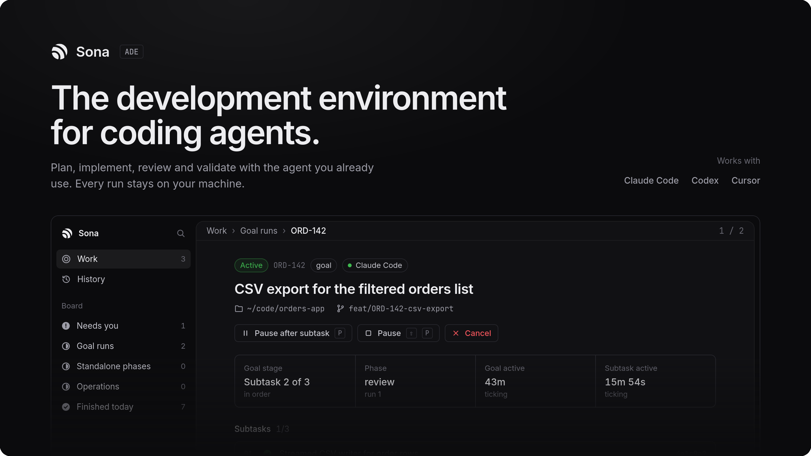
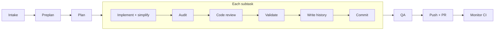
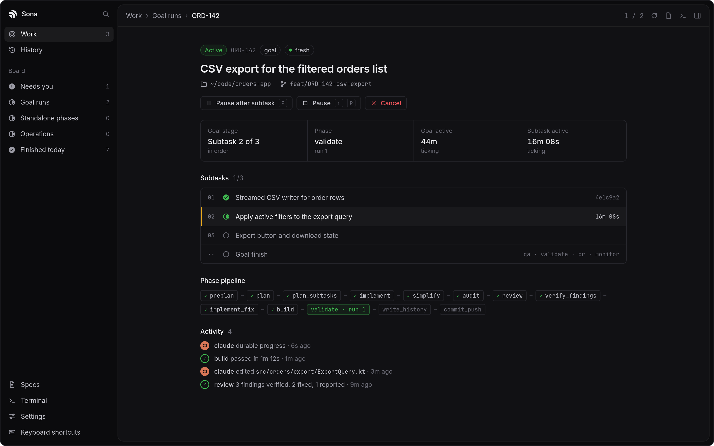
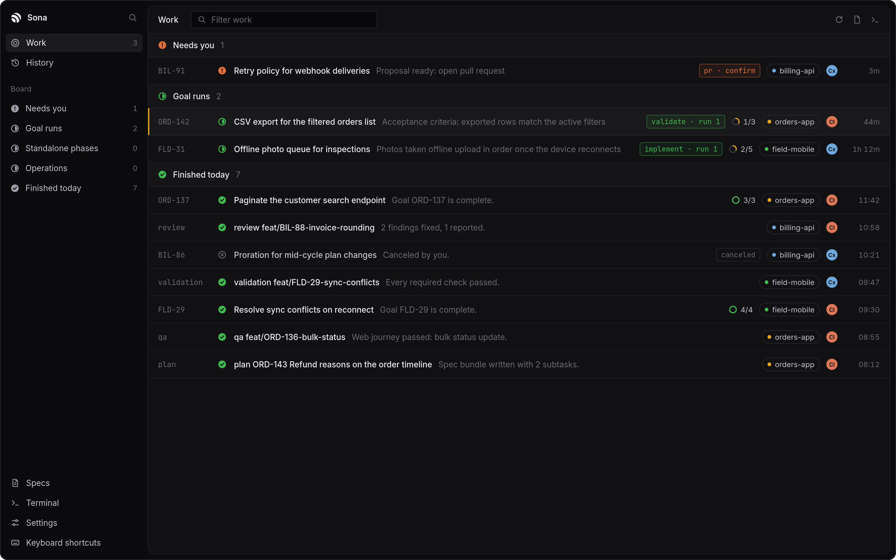
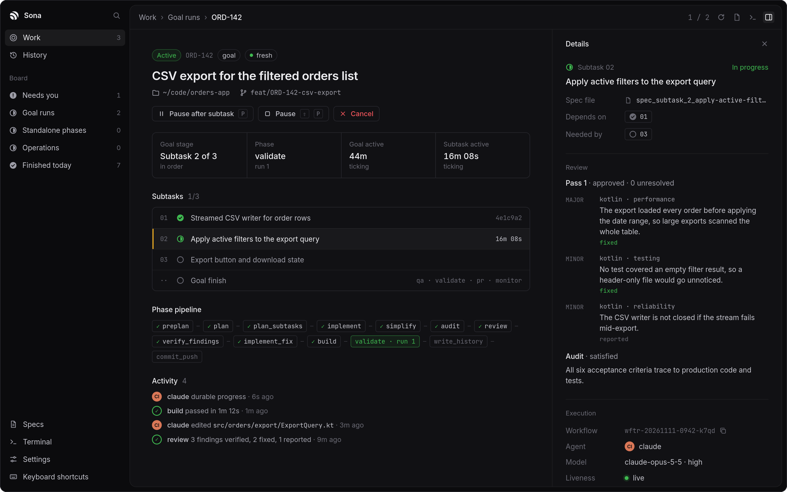

**An agentic development environment, or ADE.**
Prepare work, run coding agents, and inspect the results in one desktop app, with progress that survives interruptions.

[Quickstart](#quickstart) · [How it works](#how-it-works) · [Watching runs](#watching-and-controlling-runs) · [Platform packs](#platform-packs) · [Docs](#documentation)

---

Sona is an agentic development environment for working with coding agents across repositories. Use the desktop app to discuss new work, inspect changes and findings, and control runs. Its local runtime plans and implements features, audits acceptance criteria, reviews code, runs your project's checks, and opens pull requests. Supported projects can also run QA against the built app.

A run records its progress locally, so interrupted work can resume. You can run a complete feature workflow or choose an individual review, validation, QA, or PR task. You review the result before merging. The project is pre-1.0.

## Why Sona

- **Desktop workspace.** Prepare new work in chat, launch it with an explicit start action, and inspect progress, changes, and findings across repositories.
- **Durable runs.** Phase outputs and continuation state live in a local database. Resume with any compatible agent, because Sona stores the state independently of the agent session.
- **Acceptance criteria are checked, not assumed.** An audit compares the code and tests to each criterion and repairs gaps before review.
- **Review that fixes.** Findings are verified, Blocker and Major ones are fixed, and the rest are reported with a verdict.
- **Your project's real checks.** Validation discovers the required checks from your instructions, build files, scripts, and CI, then runs and repairs them.
- **Mobile QA.** On Android and iOS projects, an agent drives the built app on a device or simulator and fixes what it finds before the PR.
- **Stack-aware.** Platform packs route review to specialists for Go, iOS, Kotlin, KMP, PHP, Python, Rust, and TypeScript.
- **Large work splits cleanly.** Bigger features become dependency-ordered subtasks, each with a fresh context and one commit.

## Quickstart

1. Install and sign in to a supported coding agent's CLI. Follow the [installation guide](docs/getting-started.md) to install the desktop app and matching local runtime.
2. Open Sona, select your repository, and describe the work in chat. Include observable acceptance criteria, constraints, and any design references.
3. Resolve scope and open questions, accept an issue key, then click the goal start card to launch the workflow.
4. Follow the run in the desktop app. Inspect changes and findings, then review the resulting pull request before merging.

Feature work needs the target project's build tools and credentials for Git push and PR creation. See the [installation guide](docs/getting-started.md) for supported hosts, source builds, updates, and recovery.

## How it works

A goal is a complete feature workflow. A small feature is one subtask; larger work splits into dependency-ordered subtasks. Each subtask is implemented, checked, and committed on its own. When every subtask is done, the goal runs applicable QA and opens the PR.

| Stage | What happens |
| --- | --- |
| Intake | Turn the issue or requirements into a parent spec. |
| Preplan | Collect repository instructions and relevant history. |
| Plan | Split the goal into subtasks and plan each one. |
| Implementation | Implement the plan, then simplify the changes. |
| Audit | Check acceptance criteria against the code and tests, then repair gaps. |
| Code review | Review the subtask, verify findings, and fix them in bounded rounds. |
| Validation | Run the project's full checks and repair failures. |
| History and commit | Record boundary history and decisions, then commit the subtask. |
| QA | Test the built app against the goal's acceptance criteria and attempt repairs. |
| Pull request | Create or update the PR, including the QA outcome. |
| Monitor | Watch CI and repair failing checks and merge conflicts. |

QA runs when the routed platform pack declares a QA target. Specs live under `.feature-specs/` as a parent spec, per-subtask specs, and a decomposition manifest. This repository requires Linear tracking for new work through the configured `linear-sona` connection; existing local specs and historical issue keys keep their identities.

Chat preparation gathers context before a run starts. Only clicking the goal start card launches a goal from chat. A standalone planning run writes the spec bundle and stops before implementation.

### Individual tasks

You can also run selected phases or operations without launching a full feature goal:

| Task | What it does |
| --- | --- |
| Plan | Prepare a spec bundle without implementing it. |
| Review | Review a change, verify findings, and fix Blocker and Major findings. |
| Validation | Discover and run the project's full checks and repair failures. |
| QA | Report findings from testing the built app. |
| PR | Commit pending changes, push, open or update the PR, and monitor CI. |
| Monitor | Watch a PR or branch and repair CI failures and merge conflicts. |
| Verify | Audit a change against its acceptance criteria and report a verdict. |
| Review fixes | Triage review comments and fix selected findings. |

See [runtime command guidance](docs/runtime-command-guidance.md) for command syntax, available operations, and confirmation behavior.

### Skill

| Command | Purpose |
| --- | --- |
| `/sona` | Run the durable feature workflow or resume a saved goal. |

The public runtime executable is `sona`; its stdio MCP server is `sona-mcp` and
registers as `sona`. The desktop launcher is `sona-app`, and the app's visible
name is Sona. The listed skill's source remains `skills/skill-bill/`, and
internal sidecars still declare `internal-for: skill-bill`. The final SONA-5
subtask leaves `skill-bill` as a notice-only compatibility command.

## Watching and controlling runs

The desktop app lists live, recent, and stalled work across repositories. Open a goal to inspect its subtasks, pipeline, recent activity, and review, audit, and QA results. Use the run controls to pause, stop, resume, or re-run work.

Follow an active goal through its subtasks and phase pipeline. The goal view shows the current phase, elapsed time, and recent activity.

See active goals and finished runs across repositories. The work list shows each run's phase, subtask progress, repository, and recent activity.

Open a subtask's details to inspect its spec file, dependencies, review findings, audit status, and execution information.

The optional [Linux display companion](scripts/usb-display/README.md) puts tray counters and run details on a Turing 3.5-inch USB screen, with automatic paging.

## Platform packs

Packs live under `platform-packs/<slug>/`. Each manifest declares routing signals, review areas, add-ons, a validation gate, and optional QA support. Routing reads the manifests, so you can add or replace a pack without touching a hard-coded list.

| Pack | Scope | Mobile QA |
| --- | --- | :---: |
| `generic` | Fallback for unsupported, docs-only, and unresolved paths | |
| `go` | Go modules, services, libraries, and CLIs | |
| `ios` | Swift, SwiftUI/UIKit, Xcode and SPM projects | ✓ |
| `kotlin` | Kotlin/JVM, and the baseline layer for KMP | |
| `kmp` | Android and Kotlin Multiplatform | ✓ |
| `php` | PHP applications and Composer projects | |
| `python` | Python applications, libraries, services, and CLIs | |
| `rust` | Rust crates and Cargo workspaces | |
| `typescript` | TypeScript and TSX applications, libraries, and services | |

Review areas and routing rules

The ten failure-review areas are `architecture`, `performance`, `platform-correctness`, `security`, `testing`, `api-contracts`, `persistence`, `reliability`, `ui`, and `ux-accessibility`. Every shipped pack also owns a required `code-quality` lane.

KMP declares seven areas and takes `performance`, `testing`, and `api-contracts` from Kotlin. KMP's code-quality lane overrides Kotlin's, and KMP has its own quality gate with no Kotlin fallback. The other packs declare all ten areas.

Concrete path ownership beats the generic fallback, and content signals break ties between equal path matches. The fallback owner is declared in a manifest; declaring more than one fails validation.

Review specialists run within the selected workflow. See the [source-generation guide](docs/skill-source-generation.md) and [review substance standard](orchestration/review-orchestrator/platform-pack-substance-standard.md) to author a pack.

## Configuration

Choose models and reasoning effort per phase, add project instructions, and extend review guidance through platform packs and add-ons. Repository instructions belong in `AGENTS.md`; boundary history and decisions live next to the code in `agent/history.md` and `agent/decisions.md`.

See the [getting started guide](docs/getting-started.md) for configuration paths and project customization. The [source-generation guide](docs/skill-source-generation.md) covers authoring skills, packs, and add-ons.

## Supported agents

| Agent | Skill install | Governed review launches | Model overrides |
| --- | :---: | :---: | :---: |
| Claude Code | ✓ | ✓ | ✓ |
| Codex | ✓ | ✓ | ✓ |
| Cursor | ✓ | ✓ | ✓ |

## Telemetry

Telemetry defaults to `anonymous`; the installer also offers `full` and `off`. Events go to the shipped relay unless you [self-host the proxy](docs/cloudflare-telemetry-proxy/README.md).

Some diagnostic events still queue locally while telemetry is off. Workflow state is always local. [Telemetry privacy](docs/telemetry-privacy.md) lists every field, destination, and retention rule.

## Documentation

| Guide | Covers |
| --- | --- |
| [Getting Started](docs/getting-started.md) | Installation, CLI commands, MCP tools, and recovery |
| [Runtime Command Guidance](docs/runtime-command-guidance.md) | Exact behavior of every run, phase, and operation |
| [Capability Deep-dive](docs/capabilities.md) | Workflows, packs, memory, and governance |
| [Review Telemetry](docs/review-telemetry.md) | Review measurements, learnings, and local statistics |
| [Runtime Architecture](runtime-kotlin/ARCHITECTURE.md) | Module ownership, persistence, and contract enforcement |
| [Observability Policy](docs/observability-policy.md) | Required records for failures and degraded behavior |

## Contributing

See [Contributing](CONTRIBUTING.md), the [source-generation guide](docs/skill-source-generation.md), and the [scaffold payload contract](orchestration/shell-content-contract/SCAFFOLD_PAYLOAD.md) before changing contracts. The runtime and desktop app build separately.
